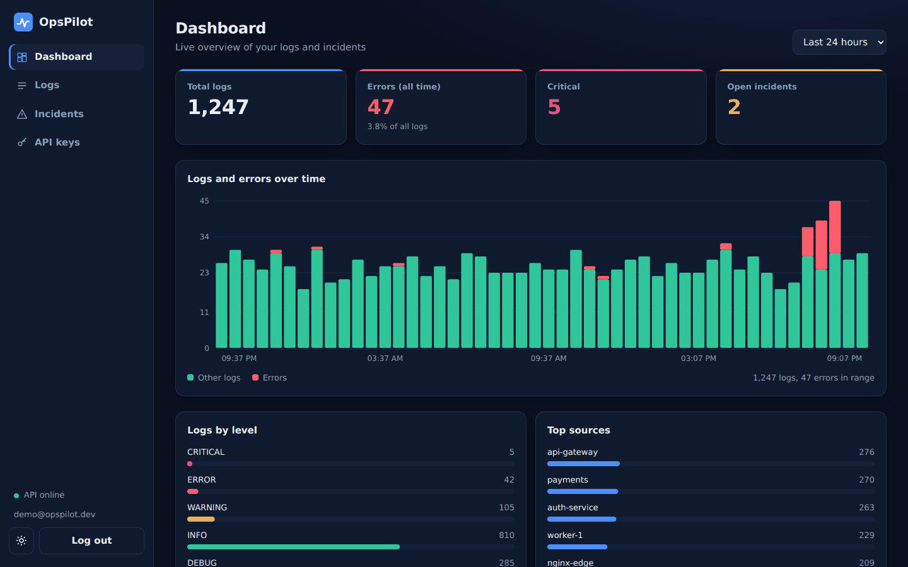
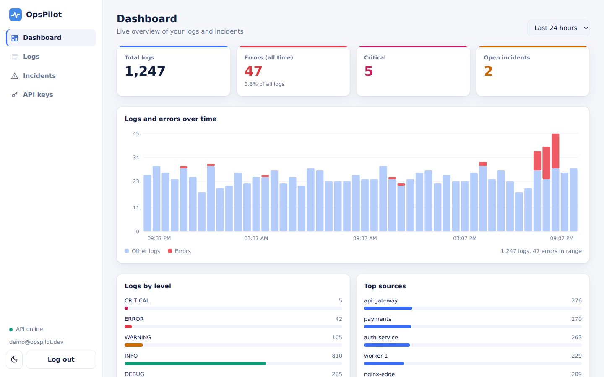
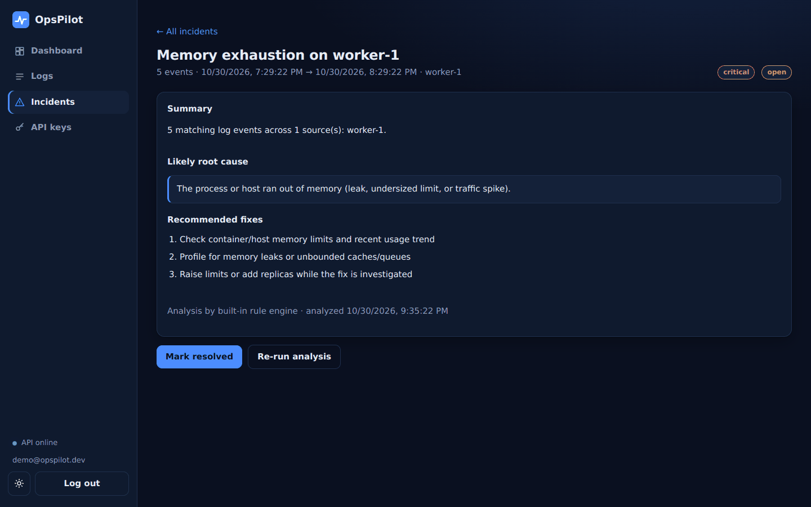
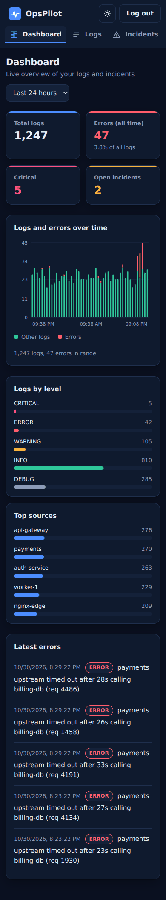

# OpsPilot

DevOps log analysis and incident management platform. Ingests logs from
servers and containers, stores them per user, and (upcoming) uses an LLM to
summarize incidents and suggest root causes.

## Status

- [x] Phase 1: Log ingestion API, database, filtering, stats, Docker, CI
- [x] Phase 2: JWT auth, user registration/login, API keys, per-user data isolation
- [x] Phase 3: Error-pattern detection, AI root-cause analysis (Claude, with rule-engine fallback), incident lifecycle
- [x] Phase 4: Monitoring dashboard (sign in/up, charts, log explorer, incidents, API keys)
- [ ] Phase 5: Alerts and notifications (thresholds, email, Slack/Teams, history, cooldowns)
- [ ] Phase 6+: Security hardening, Alembic migrations, Prometheus/Grafana, cloud deployment

## Quick start

```bash
cp .env.example .env          # set SECRET_KEY (openssl rand -hex 32)
docker compose up --build
```

Dashboard: http://localhost:8000 | API docs: http://localhost:8000/docs

Without Docker:

```bash
python -m venv .venv && source .venv/bin/activate
pip install -r requirements.txt
uvicorn app.main:app --reload
pytest -v                      # API tests
(cd e2e && npm ci && npm test)  # dashboard tests (needs the server running on :8000)
```

## Dashboard

<p align="center"></p>

<p align="center">
  
  
</p>
<p align="center"></p>

*Screenshots use generated demo data.*

Open http://localhost:8000, create an account, then:

- **Dashboard**: totals, error counts, and a chart of logs and errors over time (1h to 7d)
- **Logs**: search, filter by level/source, paginate
- **Incidents**: detected error patterns, one-click analysis, root cause and recommended fixes, resolve/reopen
- **API keys**: create (shown once), copy, revoke

It is a dependency-free single page served by the API itself (no build step). Dark "observability"
theme by default with a light "minimal" theme one click away (your choice is remembered); fully responsive
(checked at 360, 390, 768, 1024 and 1440 px). All log content is rendered as plain text, never HTML,
so hostile log lines cannot inject scripts (covered by an automated test).

## Usage

```bash
# 1. Register and log in
curl -X POST localhost:8000/api/v1/auth/register -H 'content-type: application/json' \
  -d '{"email":"you@example.com","password":"a-long-password"}'
curl -X POST localhost:8000/api/v1/auth/login \
  -d 'username=you@example.com&password=a-long-password'      # -> access_token

# 2. Create an API key for a log agent (shown once)
curl -X POST localhost:8000/api/v1/api-keys -H "Authorization: Bearer $TOKEN" \
  -H 'content-type: application/json' -d '{"name":"prod-server-1"}'

# 3. Ship logs with the key
curl -X POST localhost:8000/api/v1/logs -H "X-API-Key: $KEY" -H 'content-type: application/json' \
  -d '{"source":"nginx-1","level":"ERROR","message":"upstream timed out"}'
```

## API

| Method | Path | Auth | Description |
|---|---|---|---|
| GET | /health | none | Health check |
| POST | /api/v1/auth/register | none | Create account |
| POST | /api/v1/auth/login | none | Get JWT (OAuth2 form) |
| GET | /api/v1/auth/me | JWT | Current user |
| POST | /api/v1/api-keys | JWT | Create API key (returned once) |
| GET | /api/v1/api-keys | JWT | List keys (prefix only) |
| DELETE | /api/v1/api-keys/{id} | JWT | Revoke a key |
| POST | /api/v1/logs | JWT or API key | Ingest one log |
| POST | /api/v1/logs/batch | JWT or API key | Ingest up to 500 logs |
| GET | /api/v1/logs | JWT or API key | List logs (level, source, q, limit, offset); total in `X-Total-Count` |
| GET | /api/v1/logs/timeseries | JWT or API key | Logs and errors per time bucket |
| GET | /api/v1/logs/stats | JWT or API key | Counts by level and source |

## Incident analysis (Phase 3)

```bash
# 1. See recurring errors from the last 24h, grouped by pattern
curl "localhost:8000/api/v1/incidents/patterns?hours=24&min_count=2" -H "X-API-Key: $KEY"

# 2. Analyze one pattern -> creates an incident with summary, root cause, fixes
curl -X POST localhost:8000/api/v1/incidents/analyze -H "X-API-Key: $KEY" \
  -H 'content-type: application/json' -d '{"fingerprint":"<from step 1>","hours":24}'

# 3. Track it
curl localhost:8000/api/v1/incidents?status=open -H "X-API-Key: $KEY"
curl -X PATCH localhost:8000/api/v1/incidents/1 -H "X-API-Key: $KEY" \
  -H 'content-type: application/json' -d '{"status":"resolved"}'
```

How it works:
- **Pattern detection** is deterministic: messages are redacted, numbers/IPs/UUIDs are
  normalized into a template, and identical templates are grouped and counted.
- **Analysis** uses Claude when `ANTHROPIC_API_KEY` is set; otherwise (or if the API call or
  its output fails) a built-in rule engine for common failures (timeouts, OOM, disk full,
  refused connections, TLS, auth, 5xx, DB contention) produces the analysis. Each incident
  records `analysis_source` (`claude` or `rules`) so you always know which produced it.
- Logs are untrusted input: secrets/emails are redacted before analysis, and the prompt tells
  the model to treat log content as data, never as instructions.

| Method | Path | Description |
|---|---|---|
| GET | /api/v1/incidents/patterns | Group recent ERROR/CRITICAL logs into patterns |
| POST | /api/v1/incidents/analyze | Analyze a pattern, create/refresh an open incident |
| GET | /api/v1/incidents | List incidents (`status`, `limit`, `offset`) |
| GET | /api/v1/incidents/{id} | Incident details |
| PATCH | /api/v1/incidents/{id} | Mark `open` or `resolved` |

## Security notes

- Passwords hashed with bcrypt (SHA-256 pre-hash, so any length is safe).
- API keys are stored only as SHA-256 hashes; the raw key is shown once.
- API keys can ingest/read logs but cannot create or revoke keys.
- All log data is scoped to the owning user.
- Set a strong `SECRET_KEY` in production.
- If `ANTHROPIC_API_KEY` is set, redacted error-log excerpts are sent to the Anthropic API.

## Stack

FastAPI, SQLAlchemy 2, PostgreSQL (SQLite for local dev), PyJWT, bcrypt,
Vanilla JS dashboard, Anthropic Claude API, Docker, GitHub Actions, pytest, jsdom.

## License

MIT
